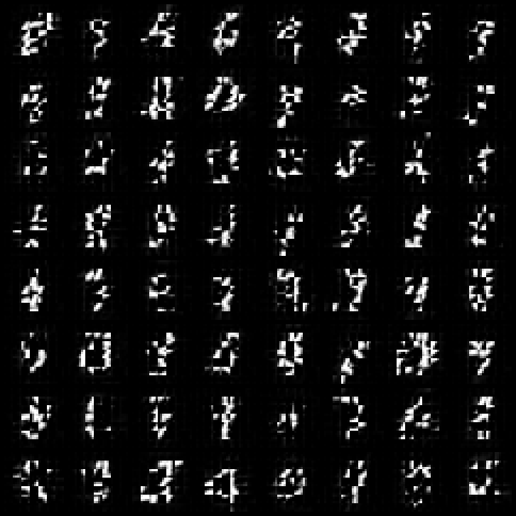

# Camel-DDPM

目标是用 Camel 从零训练通用中英文文生图模型，数据、构建与训练均放在 `ssh 88zjwei`。所有学习组件随机初始化，不使用预训练权重。完整目标、数据来源、能力缺口和验收条件见 [从零训练说明](docs/from-scratch.md)。

新增 [完整小型潜空间模型](docs/latent-training.md)：从零初始化的 VAE、文本 Transformer、4 层条件去噪 Transformer、BF16 矩阵乘和 FP32 Adam/EMA，使用 256 张分组划分的 CC0 图片在服务器训练。结构和恢复流程已经补齐，生成质量仍未达到生产级要求。原 RGB64 和 MNIST 原型作为回归保留。

**当前状态：已在远程 RTX 3090 上跑通训练和采样，背景噪点明显减少，但仍有断笔和块状接缝。** 这个仓库首先是 Camel 能力与缺口的可复现实验。



最新 RGB 实验：[批量注意力与恢复验证](docs/results/server-batched-validation.md)。MNIST 实验见 [服务器验证记录](docs/results/server-patch-validation.md)。旧 MLP 基线见下方验证结果。
最新潜空间模型：[混合精度、256 图训练与采样结果](docs/results/server-latent-validation.md)。

## 实现范围

- Camel 原生解析 MNIST IDX，归一化到 `[-1, 1]`。
- 100 步 cosine 噪声调度、16 维正弦时间编码、两层 SiLU MLP。
- epsilon 预测与均方误差；带解析噪声直连的残差参数化。
- Camel 自动微分；GPU 路径用 Camel 表达 Adam，并编译为 CUDA。
- 权重、梯度及 Adam 的两个动量树在 GPU 更新间保留在显存。
- NPY 权重、独立进程重载、fixed-small DDPM 后验与裁剪的 x0 预测。
- Camel 直接输出 PGM 样本网格和采样过程；Python 仅提供可选 PNG 转换。

GPU 路径显式调用 `tiles.run` / `tiles.run_device`，失败会报错，不会自动退回 CPU。
CPU 仍负责 IDX 读取、随机噪声、时间/调度系数、少量加噪与后验运算、图片编码和文件输出。

## 初始化独立运行环境

需要 Windows PowerShell 和包含 Tiles 的完整 Camel 分发目录。CUDA 执行还需要 NVIDIA 驱动及匹配的 NVRTC 运行库；仅 GPU 检测成功并不保证每张图可编译。

实验依赖的 Camel 库修复与批量矩阵乘扩展见 [runtime/README.md](runtime/README.md)。可用包含这些改动的分发目录安装一次：

```powershell
.\tools\install-runtime.ps1 -Distribution D:\path\to\camel-distribution
```

脚本将完整分发安装到本项目 `.camel/`，记录版本与二进制 SHA-256。之后所有运行默认使用 `.camel/bin/camel.exe`，不链接开发目录。运行时、MNIST 和训练产物均不进入 Git。显式更新时加 `-Update`；更新前应结束正在运行的 Camel 进程。

## 运行

### 在服务器上运行（当前训练位置）

后续训练已迁移至 `ssh 88zjwei` 的 `/home/zjwei/projects/Camel-DDPM`，使用该目录自己的 Linux `.camel/` 安装；本机不运行训练。
部署、GPU 选择与日志检查见 [远程训练说明](docs/remote-training.md)。
`run.sh` 提供 Linux GPU 启动入口；`run.ps1` 仍保留用于显式选择在 Windows 上运行。

新增的 `patch-x0` 实验按 4×4 图像块共享权重、进行全局位置混合，预测干净像素，固定隐藏宽度 64。
其 x0-MSE 与旧基线的 epsilon-MSE 是不同目标，数值不能直接对比。
旧模型和 checkpoint 保持 `epsilon` 配置，采样时按原配置选择网络与后验参数化。

### Windows 本地入口

```powershell
# 下载并校验原始 MNIST，然后用宿主 gzip 解压；IDX 解码在 Camel 中完成。
.\tools\prepare.ps1

# 先做短跑；默认 GPU，不可用时直接报错。
.\run.ps1 -Steps 3 -Width 16 -Batch 4 -Samples 8 -SkipPrepare

# 已验证的基线配置；约 158 秒是本机一次测量，不是性能保证。
.\run.ps1 -Steps 5000 -Width 512 -Out runs\gpu-baseline -SkipPrepare

# 独立重载 checkpoint 再采样；读取该次运行的 timesteps/device 配置。
.\run.ps1 -SampleOnly -Out runs\gpu-baseline -Samples 64 -SampleSeed 12345

# 数值检查；不重新训练。
.\test.ps1
```

默认每次 GPU 更新后暂停 10 毫秒、CPU 张量线程数为 1，并降低启动进程优先级。
`-DelayMs` 可增加暂停时间；Ctrl+C 可终止。默认不自动启动长期任务。CPU 路径需显式指定 `-Device cpu`，该路径默认也只有一个张量线程。

每次 MNIST 运行写入 `runs/<name>/`：`config.json`、日志、`metrics.json`、`timing.json`、`checkpoint/*.npy`、`samples.npy`、`samples.pgm` 和 `trajectory_*.pgm`。这些 MNIST 入口只保存模型权重，不支持恢复 Adam 状态；RGB 入口 `tools/text-image.py` 会保存模型、Adam、EMA 和训练进度并支持续训。短跑只能验证流程，不代表模型收敛。

PNG 预览是可选步骤，无需它也能训练、采样和输出图片：

```powershell
python -m pip install -r requirements.txt
python tools\preview.py runs\gpu-baseline
```

## 验证结果

2026-10-18，RTX 4060 Ti，512 隐藏宽度、batch 32、5,000 次更新、100 步扩散：

| 检查 | 结果 |
|---|---|
| 固定 128 张测试图、5 个时间点的噪声 MSE | 0.521963 → 0.371084，下降 28.9% |
| 模型方向导数与中心差分绝对误差 | 2.55e-6 |
| CPU/GPU 全部参数梯度 L1 差异 | 1.31e-7 |
| Camel GPU Adam 与 `nn.adam` 首步参数 L1 差异 | 9.80e-7 |
| 改变输入与参数后的 CPU/GPU 梯度 L1 差异 | 1.38e-7 |
| 保存重载后的损失 | 完全一致 |
| 相同权重/种子重启采样 | NPY SHA-256 完全一致 |
| 人工检查样本 | 有笔画，噪点多；生成质量未通过 |

验证时间点是按索引取的 9、29、49、69、89（总步数 100），固定噪声复用。
数据来自官方 MNIST train/test 图片文件；无需标签，因为模型无条件生成。
所有样本共享一次抽取的 batch 时间步，其边际训练目标仍为均匀时间步 epsilon MSE。
随机训练损失随时间点大幅变化，不能把单个 batch 的高低当作收敛结论。

## 发现的缺口与下一步

已补齐：标量 `math.sqrt` 反向规则、含 NUL 的二进制文件写入、Tiles 对 `numel`/`shape` 的形状特化，以及逆轴置换的 GPU 降低。实验没有改变 Camel 的语言语义。

当前瓶颈是小型全连接网络的生成质量；下一步应验证卷积去噪器或小型 U-Net。
Tiles 当前公开支持子集还不含完整卷积/池化前后向，不能直接将 CPU CNN 示例当作可用 GPU U-Net。
另外还缺 checkpoint 中的优化器状态、恢复训练、较全面的验证集评估，以及 GPU 随机数/数据输入链路。

DDPM 的原始后验与 epsilon 参数化参考 [作者实现](https://github.com/hojonathanho/diffusion/blob/master/diffusion_tf/diffusion_utils_2.py)。这里采用小模型及 cosine 调度，目标是运行链路验证，不是复现原论文质量。
