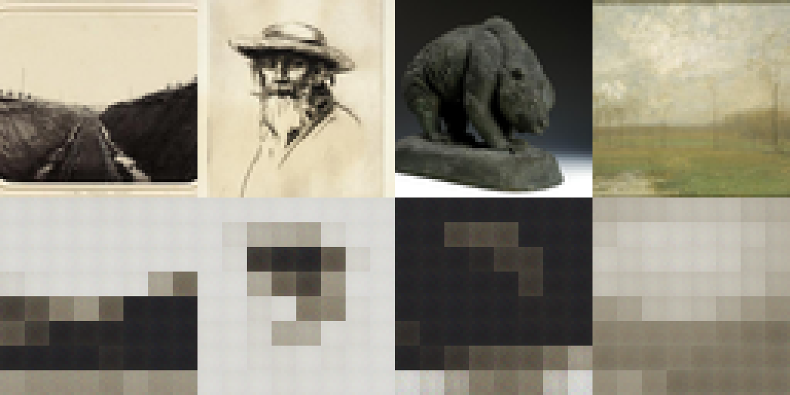
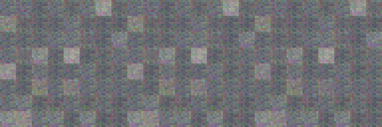

# 服务器潜空间模型验证（2026-10-18）

本轮补齐 VAE、文本编码器、条件去噪 Transformer、BF16 矩阵乘和 DDIM 采样；所有学习组件从随机初始化开始。
训练、构建和数值检查均在 `88zjwei:/home/zjwei/projects/Camel-DDPM`，使用项目自己的 `.camel/`。
架构、命令和边界见 [潜空间训练说明](../latent-training.md)。

## 环境与数据

- RTX 3090，UUID `GPU-c10aaf4f-7c2c-3fa5-f47d-bb26db738a49`，驱动 580.95.05。
- CUDA 12.3，实际 cuBLAS 文件 `libcublas.so.12.3.4.1`，SHA-256 `8bdbda040980c430fc07dd853fdebc578e51951015284e4f109de5ee345a22e6`。
- Camel 源基线 `1555bf5b` + 仓库内限定范围的 runtime patch。服务器构建 `261018_132507`。
- 256 张 CC0 图片，247 张训练、9 张验证、174 个互斥分组，来源 Smithsonian SAAM/NASM。全部为英文博物馆元数据描述。
- 封存 manifest SHA-256：`10a6be8da0d6e5b0a4dfb33095c324958ccce31cb6488178514c4b68eaefc4a7`。

## 训练与留出评估

两个阶段各训练 500 步，batch=2，seed=20261018，Adam 学习率 1e-4、全局范数裁剪 1、EMA=0.999，每 100 步发布 checkpoint。
扩散阶段固定 VAE 第 500 步 model 权重，100 个 cosine 噪声时间步。
下表均使用 model 权重；初始化对照使用相同初始化种子与同一评估输入。

| 留出指标 | 随机初始化 | 训练后 |
|---|---:|---:|
| VAE 重建 MSE，9 张 | 0.40128704 | 0.06592382 |
| 去噪 MSE，9 张 × 3 个固定时间/噪声条件 | 1.04669267 | 0.26087811 |

VAE 后验均值的留出二阶矩为 2.9068；当前不做潜变量标准化。这不是已经校准的高质量潜空间。
典型每 100 步 checkpoint 段耗时：VAE 约 26.6 秒，扩散约 49–51 秒。
计时包含进程启动、初始化、编译和保存；部分检查与训练有短暂重叠，不作为独占 GPU 吞吐基准。

上排为四张留出原图，下排为重建；仅作最近邻放大，未做生成增强。模型主要恢复低频颜色、明暗，物体细节仍明显模糊。

30 步 DDIM、CFG=2、seed=12345，三张图分别对应英文“铜熊雕塑”、英文“有树的风景画”、中文“一只站在树枝上的红色小鸟”。
当前都是模糊色块，无法辨认出对应对象。文字变化只造成少量像素变化，不能证明语义对齐。

第一条提示词重跑后，潜变量、像素 NPY 和 PPM 均逐字节一致；PPM SHA-256 为
`a0c670868d8a5c11ba0307d312c7f251a6e42967394e334bf2e34bdf8ce6e363`。
英文提示词切换的平均像素绝对差为 0.00705439，中文切换为 0.01567622。
留出噪声 MSE 改善与实际生成质量不足同时成立，不能以其中一个替代另一个。

## 正确性与恢复

- 显式完整数值授权才选择 BF16；部分授权和严格 FP32 均保留标准路径。
- 可区分 BF16 舍入与 FP32，且广播批量矩阵乘与参考结果通过检查。
- 完整 VAE 和去噪模型相对 CPU FP32 的梯度 L2 误差分别为 0.00569746、0.01121449；一次 Adam 更新后各自测试损失下降。
- 连续 4 步与 2+2 步恢复：VAE 全部 176 个、去噪模型全部 344 个权重/动量/EMA 文件逐字节相同；损坏张量被拒绝。
- Tiles 回归 58/58；DDPM 底层回归 21/21；原 MNIST、patch 和 RGB 注意力检查均通过。

服务器日志保留在 `runs/latent-checks-final/`、`runs/ddpm-mixed-regression.log`、`runs/tiles-mixed-regression.log`、`runs/project-mixed-regression.log`。
训练运行是 `runs/vae-256-mixed-v1` 与 `runs/ld-256-mixed-v1`；验证目录为 `runs/vae-256-valid`、`runs/ld-256-validation`。
所有训练 checkpoint、原始图片和运行时二进制留在服务器，不加入 Git。

这证明模型结构、GPU 数值路径和恢复流程可运行，并观察到了留出误差改善。
256 张英文博物馆图片、64px 分辨率和短训练均不足以验证通用文生图、中文对齐或生产可用性。
