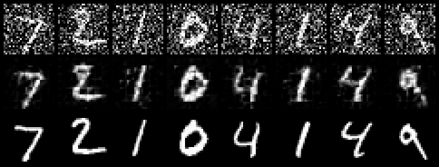

# Remote patch-x0 experiment — 2026-10-18

This run was built and trained entirely on `88zjwei`, in
`/home/zjwei/projects/Camel-DDPM`. The Windows machine performed editing, SSH,
file transfer and optional PGM-to-PNG conversion only; it did not run training.

## Configuration and result

- GPU: physical ordinal 2, RTX 3090 (sm_86), 24 GiB.
- GPU UUID: `GPU-c10aaf4f-7c2c-3fa5-f47d-bb26db738a49`.
- Runtime: project-local Linux `.camel/`, built from Camel `1555bf5b` plus the
  scoped library patch, using Clang 23 and CUDA/NVRTC 12.3.
- Model: `patch-x0`, fixed width 64, 4×4 nonoverlapping patches, shared feature
  weights and two applications of a learned 49-position spatial mixer.
- Objective: uniform-time **clean-image MSE**, not epsilon MSE.
- Training: batch 32, 5,000 Adam updates, learning rate 0.001, 100 cosine steps,
  seed 20261018, one host tensor thread, 10 ms sleep after each update.
- Generation: 64 images, 100-step fixed-small DDPM posterior, seed 12345.
- Training time including initialization and fixed validation: 96 seconds,
  measured once by the shell launcher (not a performance benchmark).
- Fixed validation MSE: **0.35259950933752415 → 0.11049011263983424**,
  ratio 0.31335866815988145 (68.7% lower than this model's initialization).
- Fresh-process resampling produced exactly the same `samples.npy` SHA-256:
  `029a28cb38c581463c077a9bc4de55c218a986c352eea949a9dc05987adff7e6`.

The validation set is the same first 128 official MNIST test images, with fixed
noise and time indices 9, 29, 49, 69, 89. The final average contains losses at all
five noise levels. It cannot be numerically compared to the old epsilon model's
0.371 noise-MSE result because the targets differ.

## Numerical checks

```text
LAYOUT gradient_error=0.0
LAYOUT changed_batch_error=0.0
PATCH roundtrip=0.0 gradient_l1=1.5291377621906577e-06 directional_error=2.14368828892475e-05 loss_before=1.4286696249388986 loss_after=1.3908896757263693
PATCH CHECKS PASS
layout_grad errors=0.0 0.0 0.0
```

The gradient check compares all trainable fields between CPU and GPU. The
directional check uses a central finite difference of the output bias. Patch
round trips test exact spatial order. Layout checks also exercise a non-self-inverse
permutation, changed batch size and negative axes. The extended Camel primitive
test plan passed **15/15** NVM/FVM/JIT cases on the server.

The old epsilon configuration also passed a two-update train/checkpoint/sample
regression on the remote runtime. The patch model's three-update smoke run passed
before the 5,000-update experiment started.

## Visual interpretation


Background speckle is substantially reduced compared with the original dense
epsilon baseline. Several samples have digit-like strokes, but many are broken
or ambiguous, and 4×4 patch seams are visible. This is an improvement in observed
sample appearance, not a claim that generation quality has converged. No FID or
classifier-based recognition score was measured.

The following diagnostic uses held-out inputs at time 49. Rows are noisy input,
predicted clean image, and ground truth, respectively. Reconstruction is visibly
better than unconditional generation; it should not be mistaken for generated
samples.



The next structural limitation is cross-patch continuity. Overlapping local
receptive fields or a convolutional/U-Net denoiser are more promising than merely
removing the noise skip from a narrow full-image epsilon MLP. Full GPU convolution
and pooling pullbacks still require additional backend work.
